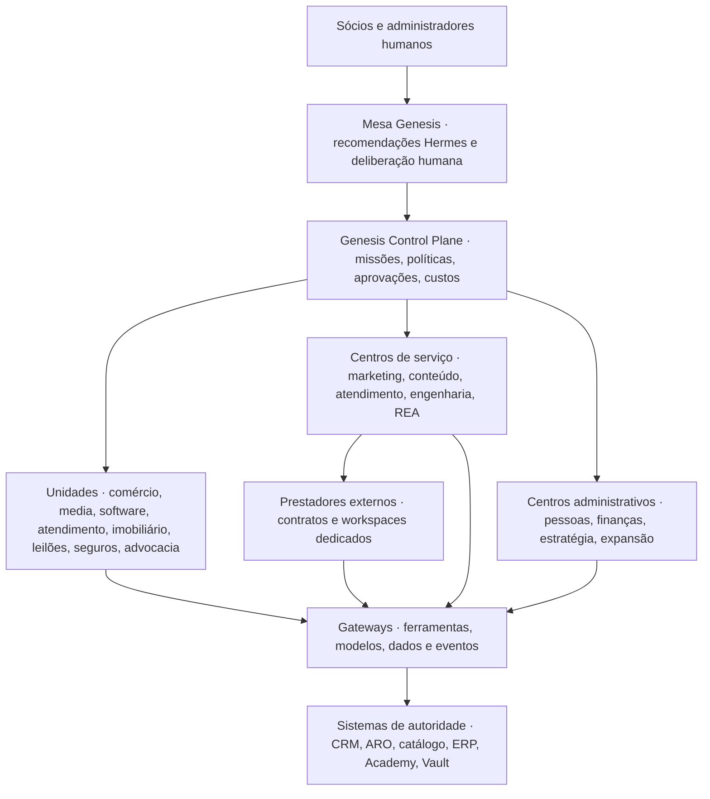

# Genesis · Arquitetura da empresa AI-nativa

**Estado:** desenho V0.1 para revisão. A demo usa operações e resultados sintéticos. As integrações de produção descritas aqui são propostas.

## 1. O que aproveitamos da GWD

O pacote GWD AI-Native Blueprint V1.0 de 4 de novembro de 2026 já contém um documento mestre, quatro ADRs, um catálogo de repositórios e tecnologias, diagramas editáveis, quatro contratos em JSON Schema, um registo de decisões e quatro runbooks. É uma boa base de diligência técnica. As classificações do próprio pacote distinguem existência em código, estado reportado, proposta e homologação. A referência a um repositório ou a um agente em funcionamento não comprova o estado do ambiente atual.

| Base GWD | Decisão Genesis | Evidência a obter |
|---|---|---|
| ADR-001, operação multi-entidade | Generalizar para holding, filiais, centros de serviço e prestadores externos | Organograma, titularidade por domínio e testes entre dois tenants |
| ADR-002, GBrain, AKH e Content Vault | Separar factos institucionais, recuperação autorizada, ativos originais e estado transacional | Origem, versão, ACL, retirada do índice e restauro |
| ADR-003, Hermes e Agency Agents | Hermes como candidato principal. Agency Agents como biblioteca de papéis. Adaptadores de runtime substituíveis | Inventário de versões, licenças, teste controlado e custo por tarefa |
| ADR-004, comércio e aprendizagem | Manter cada fonte de verdade e ligar por contrato, sem duplicar pagamento ou matrícula | Aprovação, reconciliação, reembolso e revogação verificáveis |
| Contratos de missão, agente, evento e conhecimento | Estender com unidade, titular, reserva de verba, versão da política e rastro de decisão | Schemas, exemplos válidos e inválidos, testes de isolamento |
| Runbooks Diana, GBrain, Viva Leve e crédito | Usar como referências de auditoria e ensaio. Aplicar ao Genesis por unidade | Proprietário, versão, prova, rollback e responsabilidade humana |

Na diligência, pedir SHA e ambiente observados, proprietário, licença, última evidência e risco de cada componente. Priorizar GWD, Sales OS, ARO, Knowledge Hub, Agent Packs, LearnHouse e Factory. Manter o ZIP original em espaço privado de referência. Só transferir para documentação pública excertos e diagramas sanitizados e autorizados.

## 2. Holding, unidades e serviços

Separar entidade legal, unidade económica e tenant técnico. Uma empresa pode ter várias marcas e unidades. Uma unidade pode operar vários workspaces. Um prestador pode servir mais de uma unidade com autorização própria por contrato.

**Objetos mestres.** Entidade legal tem jurisdição, representantes, moeda e obrigações. Unidade tem dono humano, portfólio, centro de custo e margem. Centro de serviço tem catálogo, filas, capacidade e custo de transferência. Workspace tem tenant, classificação de dados, contas de serviço e permissões. O acordo de serviço liga solicitante e prestador, define resultado, preço, SLA, revisores, classes de dados, subcontratação e retenção. Agente é uma capacidade implantada com identidade técnica e responsável humano. Um papel no catálogo não é por si só um agente executável.

| Unidade ou centro | Primeiras missões | Autoridade e limite |
|---|---|---|
| Comércio digital, afiliados e dropshipping | Análise de catálogo e margem, descrição, triagem de pedidos | Catálogo e ERP/ARO. Compra, preço e divulgação com aprovação |
| Media, audiência e agência | Brief, produção, revisão de fontes e direitos, proposta de campanha | Vault para ativos. Verba de mídia reservada antes de qualquer disparo |
| Desenvolvimento e serviços IT | Diagnóstico, proposta, PR e relatórios de teste | GitHub e CI. Ambiente isolado e aprovação humana para deploy |
| Atendimento e call center | Classificação, rascunho e encaminhamento | Sales OS. Acesso por contrato. Política de gravação e de contacto |
| Imobiliário e leilões | Pesquisa de mercado, triagem e organização de lotes sintéticos | Registro e operador habilitado quando aplicável. Sem lances e corretagem autónomos |
| Seguros e advocacia | Organização de informações e preparação interna de rascunhos | Profissional habilitado e revisão humana. Zero decisão, aconselhamento ou assinatura autónoma |
| R&D e REA | Experimentos, testes de regressão e engenharia reversa autorizada | Workspace de laboratório. Rever licenças, escopo e cadeia de custódia |
| Finanças | Custo, margem, reconciliação e propostas de reserva | ERP/ARO continua fonte de verdade. Aprovações segregadas |
| Gestão de pessoas e agentes | Cadastro de perfis, seleção de modelo e rotação de acesso | Separar dados de RH de fichas técnicas de agentes. Revisão de permissões |
| Estratégia, comercial e expansão | Cenários, diligência de mercado, plano por país | Dono local e revisão legal, fiscal e comercial antes de atuar |

Para os centros partilhados, medir custo por missão e cobrar internamente por hora, tarefa ou volume, conforme acordo. Distinguir preço de transferência gerencial de faturamento efetivo entre entidades, a definir por contabilidade. Utilizar prestadores externos pela mesma interface de ordens de serviço, com um tenant e contrato próprios.

## 3. Arquitetura da plataforma

| Camada | Escolha proposta | Limites |
|---|---|---|
| Portal e cockpit | Web responsiva em Vercel ou hosting equivalente. Demo isolada, com casos sintéticos | Apresentação e decisões autenticadas em planos separados. Workloads longos ficam em workers |
| Control plane | API TypeScript, PostgreSQL e uma fila de trabalhos com retries e dead-letter. Adotar uma única autoridade sobre missão, aprovação e reserva | Estado de pagamentos, CRM e estoque fica no sistema titular |
| Execução | Hermes em workers isolados, profiles e skills versionados. Adaptador definido por missão | Sem acesso direto a banco de produção, segredos ou ferramentas transacionais |
| Ferramentas | Gateway de ferramentas tipadas com identidade da missão, escopo, quotas e validação de parâmetros | MCP é transporte opcional. ACL e autorização são verificadas no servidor |
| Dados | PostgreSQL para estado. Armazenamento de objetos para evidências. Índice autorizado para recuperação. Cofre para segredos | RLS testada, chaves por ambiente, DPA e retenção. Evidências com hash e acesso assinado |
| Memória | GBrain para decisões verificadas. AKH para ingestão, busca e ACL. Content Vault para originais, direitos e evidências | Factos dinâmicos e saldos vêm da API de autoridade. Nenhuma consulta ganha acesso por texto de prompt |
| Telemetria | OpenTelemetry para rastro por missão. Logs estruturados, métricas e dashboards de custo, erro e latência | Sem prompt bruto, conteúdo de clientes ou tokens em logs. Export sanitizado para diligência |

### 3.1 Runtime, cockpit, biblioteca e modelo são camadas distintas

| Componente | Aplicação proposta | Decisão |
|---|---|---|
| Hermes Agent | Diana, apoio ao conselho, coordenação e perfis de centro. Skills, memória e tarefas com guardrails | Candidato primário para laboratório. Perfis segregados por identidade, tenant e ambiente. Escrita de memória institucional passa por serviço próprio. [Hermes Agent](https://hermes-agent.nousresearch.com/docs/) |
| OpenClaw | Adaptador para um piloto de atendimento multicanal, com gateway dedicado por fronteira de confiança | Validar sandbox, rede e gestão de sessões. Não usar um gateway partilhado como fronteira entre clientes não confiáveis. [OpenClaw Security](https://docs.openclaw.ai/gateway/security) |
| Paperclip ou fork Atlas | Avaliar hierarquia, delegação, observabilidade de custos e aprovações como cockpit/adaptador | Exercício em paralelo com o control plane do Genesis. Se adotado, eleger autoridade única por domínio e mapear as transições. [Paperclip Core Concepts](https://github.com/paperclipai/paperclip/blob/master/docs/start/core-concepts.md) |
| DeepSeek API | Candidato a fornecedor de modelo para tarefas internas permitidas, sob routing, orçamento e benchmarks | Revisar condições comerciais, dados, retenção e jurisdição. Comparar custo efetivo por tarefa aprovada, não apenas preço por token. [DeepSeek API](https://api-docs.deepseek.com/quick_start/pricing/) |
| DeepSeek harness | Adaptador ou código próprio a avaliar. O inventário GWD menciona um repositório Atlas com esse nome | Confirmar licença, versão, escopo, forma de execução e testes antes de promover. A existência da API não homologa o harness |
| Agency Agents e Atlas Agent Packs | Catálogo de funções, instruções e artefatos. Seleção lazy por missão e skills aprovadas por versão | Rever upstream, licença e dependências. Um prompt ou papel importado nunca concede ferramentas ou autoridade. [Agency Agents](https://github.com/msitarzewski/agency-agents) |

**Critérios de seleção.** Para cada unidade, comparar o mesmo conjunto de casos com Hermes, alternativa e baseline manual. Medir taxa de conclusão verificada, classificação de exceções, falso positivo, custo total por caso, p95 e tempo de revisão. Zero violações de escopo ou aprovação para promover. Qualquer nova versão de runtime, modelo, skill ou conector refaz a avaliação de risco aplicável.

### 3.2 Ficha de agente e landing page de especialidade

O GitHub guarda o manifesto interno `agent.yaml`, com `role_id`, runtime e versão, `human_owner`, workspace, `skill_refs`, escopos de ferramentas, bases de conhecimento, classificação admissível, orçamento, regras de aprovação, testes, rollback e estado. A ficha `public-profile.json` pode expor nome, área, resultados esperados, exemplos sintéticos e a última evidência aprovada. Nenhum perfil público inclui SOUL interna, conectores, prompts privados, segredos, identidade de clientes ou custos contratuais.

Modelar primeiro os papéis de Diana (coordenação), Planeamento (síntese e alternativas), Financeiro (margem e reservas), Comercial (catálogo e jornada), Growth (plano de mídia), Factory (conteúdo e direitos), QA (evidência independente), Segurança (riscos) e REA (experimentos autorizados). Os cartões apresentam a função e o que a equipa humana revê. Disponibilizar um exemplo de entrada e saída por especialidade.

## 4. Fluxo representativo

Uma unidade de comércio quer lançar uma campanha para um produto fictício. Diana enquadra a missão e identifica a entidade, orçamento, canais e prazo. Growth produz um plano. Factory prepara os ativos e demonstra origem e direitos. Financeiro calcula margem, guarda estimativa e solicita reserva. Segurança avalia acesso e canal. QA valida rastreabilidade, claims e critérios de aceite. Os agentes da Mesa registam pareceres. Um decisor humano revê a proposta e aprova, pede revisão ou recusa.

Uma aprovação de produção teria de identificar o alvo exato, o teto de gasto e a versão dos ativos. Um executor separado recebe apenas o token de ação com validade limitada e revalida a reserva no momento de agir. O retorno do provedor entra como evento idempotente. O verificador compara orçamento com custo real, regista o resultado e encerra a missão. Se o anúncio já foi publicado, cancelar ou interromper a campanha é uma compensação, pois não desfaz impressões nem custos já ocorridos.

| Ramo da demo | Comportamento esperado |
|---|---|
| Campanha normal | Comércio Digital solicita, Growth prepara, Financeiro avalia a verba e o Conselho Humano decide. O rastro apresenta o resultado simulado |
| Acima do limite | O pedido de campanha fica bloqueado antes de qualquer efeito. O responsável pode rever a verba e reapresentar |
| Dado restrito | A classificação impede o envio ao ambiente ou ferramenta sem autorização. A interface explica o bloqueio sem expor o conteúdo |
| Recusa humana | A missão termina ou volta para revisão conforme a política. O executor permanece bloqueado |

A demo apresenta esses quatro caminhos com dados sintéticos. Reserva atômica, segregação de contas, fila durável, integração de anúncios e compensação são requisitos do piloto descritos nesta arquitetura.

### 4.1 Contratos de dados e eventos

| Objeto | Campos e regras mínimas |
|---|---|
| Missão | `id`, tenant, entidade, unidade, workspace, objetivo, dono humano, agente e runtime, classe, budget e moeda, deadline, política, estado, evidências e referências de aprovação |
| Implantação | Agente e papel, versão de modelo/harness/skill, imagem ou SHA, aprovador, escopos, quota, kill switch, data e estado |
| Reserva | Verba por categoria, moeda em unidades menores, centro de custo, saldo disponível, teto, validade, custo observado, fornecedor e estado. Atualização atômica |
| Decisão | `proposal_hash`, classe, rastro de pareceres, aprovadores humanos autenticados, evidências, limite, validade, política, decisão e motivo |
| Evento | `event_id`, versão, tipo, instante UTC, tenant e entidade, origem, correlação, causação, chave idempotente, classificação e referência de payload |
| Ativo e fato | Dono, origem, versão, hash, ACL, finalidade, validade, direitos, estado de revisão e data de retirada de derivados |

Usar transação para alteração de estado e outbox. O consumidor deduplica antes de produzir efeito. A publicação de eventos não concede autoridade. Novos produtores e consumidores passam por testes de contrato. Ao lidar com dinheiro, guardar unidades menores inteiras por moeda e reconciliar com a fonte de pagamento. Mensagens sem prova de aprovação, com versão divergente, autorização expirada ou origem desconhecida saem da fila normal e geram alerta.

**Estados centrais.** `REQUESTED → SCOPED → PLANNED → QA → APPROVAL_REQUIRED → APPROVED → QUEUED → RUNNING → VERIFIED → CLOSED`. A política define quais classes pulam o gate formal. Rotas explícitas para `REWORK`, `BLOCKED`, `REJECTED`, `FAILED` e `CANCELLED`. Se houver efeito reversível, registar `ROLLED_BACK` apenas após verificar a compensação. Logs de operação devem preservar a versão da transição e o motivo.

## 5. Fronteiras, implantação e recuperação

1. **Demo.** Fixtures sintéticas, orçamento ilustrativo, sem contas externas. Demonstrar avanço, recusa, reprocessamento e rastro.
2. **Laboratório.** Novo projeto, workspace e chaves limitadas. Pinar imagens e deps. Usar fornecedor com limite de despesas. Ensaiar custo, autenticação, isolamento e restore. Nada de apontar para serviços de produção a partir de scripts de bootstrap.
3. **Staging.** Dois tenants independentes, mensagens simuladas, pagamentos em ambiente de teste, simulação de falhas, ida e volta da aprovação e revogação. Verificar que HTML, e-mail, ficheiros e respostas externas são dados potencialmente adversariais.
4. **Piloto limitado.** Uma operação, janela e volume aprovados. Só conectores necessários, credenciais temporárias, allowlist de destino, instrumentação, alertas e pessoa de plantão.
5. **Escala.** Revalidar risco por unidade, jurisdição e tipo de dados. Habilitar integrações específicas por contrato e por decisão. Dados, certificados e chaves não transitam entre ambientes.

**Controles de referência.** Workloads em rede privada, egress com lista explícita, segredos por identidade e tarefa, autenticação forte para operadores, logs apendáveis e revisão de políticas no servidor. A pesquisa usa a ACL antes do retrieval. Testar idempotência, repetição fora de ordem, expiração de aprovação, reprocessamento, negativa por tenant, manipulação de prompt, saldo esgotado, provedor indisponível, revogação de credencial e restauro.

**Runbook de incidentes.** 1) Pausar agente, fila e adaptadores afetados. 2) Revogar tokens e isolar destino ou fornecedor. 3) Preservar trilha e identificar transações e evidências. 4) Reconciliar com a autoridade. 5) Fazer rollback de configuração ou executar compensação sob aprovação. 6) Restaurar a última versão homologada, provar integridade e obter autorização de retoma. Propor metas iniciais RPO de 24 h e RTO de 4 h apenas para o piloto interno. Homologar por ensaio antes de publicar SLA.

## 6. Onde cada peça vive

- **GitHub privado** para código, schemas, manifests, ADRs, testes e tags de evidência. Trilha de auditoria transacional fica no sistema. Uma edição pública separada pode mostrar exemplos e docs sanitizados.
- **GitBook** para documentação navegável de arquitetura, APIs e portfólio, sincronizada a uma árvore de documentação própria. Publicação só a partir da versão pública.
- **Notion** para pauta, tarefas e reuniões. Referenciar a versão da proposta e das evidências. Assinatura formal e aprovação de máquina ficam em sistemas próprios.
- **Vercel ou Sites** para apresentação e cockpit. Usar preview separado e proteger a versão de diligência.
- **AtlasClub e Campus** para aprendizagem, desafio e comunidade. A eventual integração de direitos comerciais com o Campus usa notificações autenticadas e reconciliação. [Hotmart Webhook](https://developers.hotmart.com/docs/pt-BR/tutorials/use-webhook-for-subscriptions/)
- **Data room privado** para cap table, contratos, materiais de diligência e acesso temporal. Modelos, clientes e pessoas não recebem acesso por participação na comunidade.

