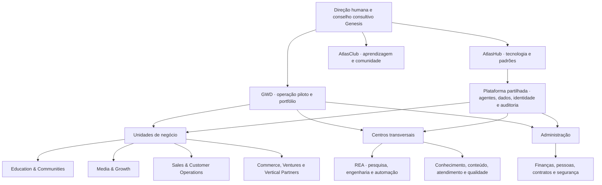

# Genesis × GWD · Plano de fundação operacional

Versão 0.3 · 5 de novembro de 2026 · Documento de trabalho para decisão do fundador e diligência. Valores em BRL. A arquitetura é uma proposta. As simulações não demonstram receitas, clientes, execução autónoma, constituição de uma holding ou direitos de investimento. A fonte calculável é [gwd-model.json](../data/gwd-model.json).

## 1. Tese e proposta de valor

**A AtlasHub desenvolve a capacidade tecnológica. A GWD é o piloto de uma operadora de negócios AI-Native. O Genesis organiza a demonstração, os projetos, a aprendizagem e a futura expansão.**

A GWD organiza trabalho empresarial com uma combinação de agentes, software, conhecimento autorizado e pessoas responsáveis. O cliente compra uma entrega delimitada — conteúdo aprovado, atendimento organizado, oportunidades qualificadas ou um processo implantado — com preço, prazo, nível de serviço e evidências. A eficiência vem da reutilização dos componentes e da melhoria dos processos; precisa de ser medida por contrato.

O primeiro objetivo é uma operação repetível que vende, entrega, recebe, aprende e presta contas. O portfólio pode ser amplo no papel. O capital de execução concentra-se em duas frentes comerciais e na Academy como canal de distribuição e aprendizagem.

**Sequência proposta:** Academy/AtlasClub e Media & Growth para aproveitar materiais e audiência existentes; Sales & Service como primeiro serviço recorrente B2B; Solutions presta a implantação delimitada desses fluxos. Viva Leve é candidata a marca demonstradora, dependente de auditoria da oferta e da operação. Crédito/Portal.Sematos permanece candidato sujeito a parceiro e enquadramento verificados.

Essa proposta é coerente com a tese de vender serviços concluídos apoiados por IA discutida pela Sequoia. A tese fundamenta uma hipótese comercial; não prova rentabilidade da GWD. [Sequoia · Services: The New Software, 5/3/2026](https://sequoiacap.com/article/services-the-new-software/).

## 2. O que existe, o que será construído e como provar

| Componente | Evidência disponível nesta etapa | Evidência exigida para estado operacional |
|---|---|---|
| AtlasClub e Atelier | Oferta e configuração relatadas pelo titular; material e canais trabalhados no histórico | Compra, acesso, conteúdo disponível, suporte e recebimento conciliados no produto atual |
| Demo Genesis | Simulação web e documentação local | Fluxo sintético reproduzível, distinção clara entre simulação e conexões reais |
| GWD | Documento estratégico fornecido pelo titular | Entidade operadora, produtos, contas, contratos, responsáveis e indicadores conferidos |
| Hermes, GBrain, Sales OS, ARO | Componentes citados no blueprint | Inventário de repositórios/versões, testes, acesso, licença, custo, responsável e ambiente alvo |
| Viva Leve / Portal.Sematos | Candidatos presentes no documento | Oferta e parceiro validados, fluxo fim a fim, direitos e métricas |
| Rede de unidades setoriais | Portfólio de expansão | Demanda, dono, capacidade, permissões, contrato e economia unitária |

Cada projeto terá um estado explícito: ideia, especificado, demo, piloto contratado, operacional, em expansão, pausado ou encerrado. “Aguardando recursos” é uma necessidade financeira adicional ao estado técnico. A página pública deve indicar data da evidência e próxima entrega.

## 3. Organização do grupo

O desenho representa responsabilidades de gestão. A separação jurídica entre AtlasHub, GWD e outras marcas depende de decisão, instrumentos e evidência próprios. Uma marca ou unidade no organograma não é uma sociedade constituída. Contratos internos, cessão/licença de IP e serviços partilhados devem identificar a entidade que assume cada obrigação.

### Mandatos por departamento

| Área | Responsabilidade | Papel de IA proposto | Dono humano / indicador |
|---|---|---|---|
| Direção e portfólio | Prioridade, alocação de capital e encerramento | Hermes sintetiza propostas e encaminha missões | Fundador e direção competente; caixa e metas por ciclo |
| Secretaria técnica | Evidências, atas e dependências | Diana organiza informação e comunica limites | Secretaria humana; decisões com dono e prazo |
| Estratégia e mercado | Pesquisa, entrevistas e proposta comercial | Analista de mercado prepara fontes e alternativas | Comercial; entrevistas convertidas em propostas |
| Finanças e controlo | Orçamento, conciliação, cobrança e gestão de caixa | Agente financeiro classifica e assinala desvios | Financeiro; margem e recebimentos conciliados |
| Pessoas e agentes | Competências, contratos, acesso e avaliações | Catálogo de skills, versões, limites e custos | Responsável humano; capacidade e falhas por função |
| Jurídico, privacidade e contratos | Entidades, termos, dados e riscos | Triagem documental com revisão profissional | Profissional responsável; contratos aprovados |
| Engenharia / REA | Integrações, releases e avaliação técnica | Construtores em ambiente isolado | Dono técnico; sucesso do fluxo e tempo de recuperação |
| Segurança e plataforma | Identidade, segredos, backup e observabilidade | Detetor de anomalias sem poder de autoaprovação | Operador; incidentes, restaurabilidade e acesso |
| Conhecimento / GBrain | Fontes, proveniência, atualização e recuperação | Curador e pesquisador com ACL | Curador; respostas sustentadas e fontes válidas |
| Media & Growth | Briefing, produção, revisão e distribuição | Redator, designer e analista com papéis versionados | Editor; prazo, retrabalho e custo por peça |
| Sales & Service | Qualificação, CRM e atendimento | Assistente com limites de canal e escalonamento | Comercial/suporte; resposta, resolução e conversão |
| Academy / Club | Formação, comunidade e projetos de laboratório | Tutor e facilitador de exercícios | Formador/moderação; ativação, retenção e conclusão |
| Procurement / Commerce | Fornecedores, catálogo, margem e entregas | Comparação e organização autorizadas | Comprador humano; margem após devoluções |
| Qualidade e operações | Aceite, indicadores e melhoria | Verificador independente da execução | Responsável operacional; defeitos e evidências |

Um fundador pode acumular várias responsabilidades no arranque; deve registar o tempo e os conflitos. A revisão de ações financeiras, acesso crítico ou compromissos materiais deve ter segunda pessoa autorizada ou procedimento externo adequado. Criar quinze nomes de agentes não exige quinze servidores nem quinze mensalidades.

## 4. Portfólio faseado de 18 verticais

| Onda | Unidade | Produto inicial | Condição de avanço |
|---|---|---|---|
| 1 | Education & Communities | Cursos, comunidade e laboratórios | Entrega e acesso demonstrados |
| 1 | Media & Growth | Produção mensal limitada | Amostras aprovadas, custo e procura |
| 1 | Sales & Customer Operations | Um funil e atendimento assistido | Cliente piloto e escalonamento humano |
| 1 | Marcas digitais / Viva Leve | Uma oferta de marca própria | Direitos, canal e margem demonstrados |
| 1 | Comércio e afiliados | Catálogo pequeno ou produtos digitais | Comissão e receita separadas de GMV |
| 1 | Creator Operations | Operação para especialista | Contrato, direitos e distribuição |
| 1 | Solutions / AI-First | Diagnóstico e implantação de um fluxo | Escopo e critérios de aceite |
| 2 | Accounting Operations | Apoio administrativo a escritórios | Parceiro profissional e limites definidos |
| 2 | Insurance Operations | Marketing e relacionamento para corretoras | Parceiro e enquadramento verificados |
| 2 | Real Estate Operations | Conteúdo, CRM e agenda | Parceiro e responsabilidades definidos |
| 2 | Crédito / Portal.Sematos | Operação informativa e encaminhamento | Contrato e validação especializada |
| 2 | Talent & People | Triagem assistida e onboarding | Critérios, privacidade e revisão humana |
| 2 | Travel & Hospitality | Concierge e operação de reservas | Fornecedores e integrações reais |
| 2 | Local Business & Franchises | Atendimento por estabelecimento | Um piloto com SLA medido |
| 3 | Health Administration | Agenda e documentação administrativa | Avaliação de dados e responsabilidade |
| 3 | Legal Operations | Organização documental | Responsável profissional e uso delimitado |
| 3 | Procurement B2B | Pesquisa e acompanhamento de compras | Mandatos e segregação financeira |
| 3 | Managed IT & Security | Suporte e monitorização | Equipa responsável e cobertura de incidentes |

As ondas são prioridades internas. Não representam datas de lançamento garantidas. As verticais especializadas começam por serviços a operadores e profissionais existentes. A constituição ou exploração de atividade regulada exige avaliação específica. Não alocar receita às unidades da onda 2 ou 3 antes de contrato e capacidade verificáveis.

## 5. Ofertas para validar comercialmente

| Oferta | Preço de planeamento | Entrega delimitada | Limites |
|---|---:|---|---|
| AtlasClub | R$49,90/mês | Conteúdo e atividades explicitamente disponíveis na oferta | Preço a confirmar no produto atual; sem quotas societárias |
| Atelier de arranque | R$147 | Oferta aprovada pelo titular, três encontros e materiais | Vendas futuras exigem turmas reais; acesso Club incluído não gera assinatura adicional |
| Media & Growth piloto | R$1.500/mês | 8 peças estáticas, 2 roteiros, 1 canal e relatório | 2 rondas de revisão; vídeo final e verba de anúncio separados |
| Sales & Service piloto | R$2.200/mês | 1 funil, 1 base de conhecimento, até 300 conversas assistidas | Sem voz e sem uso ilimitado; cobertura humana contratada |
| Implantação | R$2.500/projeto | 1 diagnóstico, 1 fluxo de baixo risco e 1 integração | Até 18h de coordenação e pacote técnico delimitado |

Preços B2B são propostas internas para entrevistas e propostas individuais. Não foram validados por vendas ou benchmarking. O escopo precisa de teste para confirmar que cabe nos custos. Entrada de caixa só ocorre após contratação, condições de pagamento e recebimento. Setup é receita pontual. Clube e mensalidades B2B são recorrência potencial, sujeita a retenção. Material, anúncio, comissão e tributo são classificados uma única vez.

## 6. Fluxo operacional demonstrável

```mermaid
flowchart LR
  L[Lead com finalidade e consentimento] --> Q[Qualificação e necessidade]
  Q --> P[Proposta com preço, escopo e responsável]
  P --> H[Aceite e autorização humana]
  H --> B[Contrato, cobrança e acesso]
  B --> O[Onboarding e fontes autorizadas]
  O --> M[Hermes cria missão com orçamento]
  M --> K[GBrain recupera contexto permitido]
  K --> A[Agentes executam tarefas delimitadas]
  A --> V[Qualidade e revisão humana]
  V --> E[Entrega e aceite]
  E --> F[Conciliação de receita, custo e SLA]
  F --> I[Melhoria documentada]
  I --> M
```

Cada missão contém organização, cliente, dono, objetivo, dados permitidos, limite de gasto, prazo, saída esperada e critério de aceite. Eventos ligam pedido, proposta, autorização, execução, custo e resultado. Separar cliente e finalidade na memória. Armazenar referências e trechos autorizados; segredos permanecem em gestão de credenciais.

O escritório 3D é um mapa da organização. Clicar numa sala deve mostrar mandato, agentes propostos, processo, projeto, custo e evidência. Luzes e movimento representam estado de demo quando não existe integração operacional. O grafo do conhecimento mostra proveniência, classes e relações; não expõe documentos internos por ser visualmente atraente. A integração real deve ocorrer por contratos/API e eventos, com modo demonstração visível enquanto não estiver conectada.

## 7. Custos de arranque revistos

Os cenários anteriores incluíam contratação e expansão antecipadas. Este modelo parte de operação remota, equipamentos existentes e fundador com 100 horas mensais disponíveis. Despesas já pagas só entram como caixa incremental se aumentarem por causa do projeto. A parcela económica atribuída aos ativos existentes aparece separadamente. Esta diferença reduz o dinheiro inicial necessário sem apagar o valor do trabalho.

| Caixa mensal | Arranque | Piloto | Tração |
|---|---:|---:|---:|
| Hospedagem e dados | 180 | 250 | 500 |
| IA interna e avaliações | 120 | 200 | 450 |
| Ferramentas | 120 | 180 | 300 |
| Backup e observabilidade | 80 | 120 | 200 |
| Administração e apoio contabilístico | 350 | 500 | 900 |
| Aquisição / testes de canal | 300 | 800 | 2.000 |
| Revisão e suporte contratado | 200 | 1.200 | 4.000 |
| Remuneração do fundador em caixa | 0 | 2.000 | 4.000 |
| **Fixo de caixa por mês** | **1.350** | **5.250** | **12.350** |
| Trabalho fundador ainda não remunerado | 5.000 | 3.000 | 1.000 |
| Ativos/licenças existentes atribuídos | 250 | 250 | 250 |
| **Custo económico base por mês** | **6.600** | **8.500** | **13.600** |

Valores são envelopes para cotação e limites de consumo, sem preços garantidos de fornecedores. O apoio humano contratado usa uma hipótese de R$50/h — 4, 24 ou 80 horas mensais — com contrato adequado e eventual ajuste de encargos. As horas remuneradas do fundador usam o mesmo valor apenas para planeamento. O trabalho não remunerado é exclusivamente dedicação própria do fundador no modelo. Não se pressupõe trabalho produtivo gratuito de alunos ou candidatos.

As rubricas de IA interna e revisão base excluem consumo técnico e produção diretamente comprados para entregar cada contrato, que aparecem no custo variável. A revisão de fornecedor e a entrega direta devem ser atribuídas por tarefa para evitar dupla contagem. Se licenças existentes não puderem ser partilhadas ou faltar capacidade de máquina, a diferença torna-se custo incremental antes de prometer a entrega.

### Economia mensal ilustrativa

| Indicador | Arranque | Piloto | Tração |
|---|---:|---:|---:|
| Membros pagos independentes | 10 | 30 | 80 |
| Vendas de Atelier no mês | 10 | 20 | 30 |
| Contratos Media | 1 | 2 | 4 |
| Contratos Sales | 0 | 1 | 3 |
| Implantações no mês | 0 | 1 | 2 |
| **Receita bruta** | **3.469,00** | **12.137,00** | **26.002,00** |
| Entrega direta | 580,00 | 2.140,00 | 4.590,00 |
| Reserva de taxas de pagamento | 281,28 | 763,44 | 1.536,24 |
| Provisão tributária de planeamento, 8% | 277,52 | 970,96 | 2.080,16 |
| Reserva de devoluções, 2% | 69,38 | 242,74 | 520,04 |
| Fixo de caixa | 1.350,00 | 5.250,00 | 12.350,00 |
| **Resultado operacional de caixa modelado** | **910,82** | **2.769,86** | **4.925,56** |
| **Resultado económico após dedicação e ativos existentes** | **−4.339,18** | **−480,14** | **3.675,56** |

Este quadro representa um mês de regime hipotético. A provisão de 8% não é uma determinação tributária e precisa de ser substituída pelo regime aplicável. Taxas de 12% educação e 3% B2B são reservas, não condições confirmadas de Hotmart ou adquirente. Não contempla depreciação adicional, despesas extraordinárias, financiamento e imposto sobre lucro que venha a ser aplicável. Remuneração, contratos, contribuições e encargos precisam de orçamento final.

O resultado positivo de caixa no arranque coexiste com resultado económico negativo porque o fundador suporta trabalho. A decisão de investimento deve mostrar ambos. Sob o mesmo mix, o ponto de equilíbrio de caixa é cerca de R$2.072 / R$7.946 / R$18.589 de receita mensal; calculá-lo com margem de contribuição observada antes de definir metas. Arredondamentos e unidades discretas alteram o resultado.

### Capacidade humana e procura

O modelo reserva 40h/mês para direção, vendas e operação dos encontros. Coordenação/revisão por unidade usa 0,15h por membro, 0,20h por aluno Atelier, 8h por cliente Media, 12h por Sales e 18h por implantação. Total necessário é 51,5h / 94,5h / 162h. Capacidade disponível é 104h / 124h / 180h, somando fundador e revisão contratada. Produção técnica comprada incluída nos custos diretos é adicional e deve ter entregáveis próprios.

No cenário de tração restam apenas 18h para desvios. Duplicar pedidos, incluir voz, revisar vídeos ou absorver grandes clientes requer elevar preço, reduzir volume ou acrescentar capacidade. Horas libertadas por IA são capacidade potencial; não entram como receita. O modelo não pressupõe que venderá todos os volumes ou conseguirá as taxas de conversão necessárias.

### Caixa para 90 dias sem recebimentos

| Uso ou reserva | Arranque | Piloto | Tração |
|---|---:|---:|---:|
| Três meses de fixo | 4.050 | 15.750 | 37.050 |
| Montagem incremental | 750 | 1.500 | 3.000 |
| Reserva de giro | 1.000 | 2.500 | 6.000 |
| Contingência de 15% | 870 | 2.962,50 | 6.907,50 |
| **Envelope de caixa** | **6.670** | **22.712,50** | **52.957,50** |

A primeira opção é financiar um sprint com caixa próprio e vendas antecipadas de serviços contratados. O envelope é uma necessidade operacional hipotética, não uma meta pública de emissão de quotas. Não inclui criação de LLC/LTDA, operação física, aquisição de empresas, licenças setoriais, custos de rodada ou estoque. Custos variáveis acompanham vendas; a reserva de giro cobre apenas atrasos dentro do seu limite. Preferir pagamento de setup e primeiro mês antes da entrega quando contratualmente acordado. Recebimentos em atraso exigem atualização do fluxo de caixa.

Para projeção dos primeiros três meses, usar realização de 25%, 50% e 75% do mês de regime como cenário ilustrativo, com custos fixos integrais. Também mostrar o caso de zero vendas e o dobro do custo de revisão. Crescimento é decisão por evidência, não linha automaticamente ascendente.

## 8. Plano de execução em 90 dias

| Janela | Entregas e responsável | Evidência de passagem |
|---|---|---|
| Dias 1–7 | Fundador define entidade e oferta; engenharia inventaria sistemas; operações publica catálogo de estado | Uma lista de ativos auditada, orçamento limitado, oferta clara e responsável por cada processo |
| Dias 8–15 | Comercial faz 10 entrevistas; Media produz amostras; engenharia liga um CRM e base autorizada em teste | Problema confirmado, amostras revistas, fluxo synthetic-to-human reproduzível |
| Dias 16–30 | Fechar até 1–2 pilotos com escopo; entregar primeiro ciclo; Academy promove sessão demonstrativa | Contrato, pagamento e entrega conciliados; registo de custo e horas |
| Dias 31–60 | Repetir entrega, melhorar base de conhecimento, testar um canal comercial | Duas entregas aceites, margem de contribuição positiva e incidentes tratados |
| Dias 61–90 | Renovar contratos, publicar case autorizado e deliberar expansão | Retenção, esforço humano, consumo e caixa medidos; decisão documentada |

Metas comerciais são hipóteses operacionais. Não prometer novos empregos, salários, dividendos ou retorno aos participantes. Criar funções e contratações quando houver necessidade, capacidade financeira e seleção documentada.

## 9. Indicadores e reunião de conselho

Relatório semanal por unidade inclui leads consentidos, entrevistas, propostas, contratos, receita faturada, receita recebida, MRR, cancelamentos, devoluções, margem de contribuição, custo de aquisição, horas humanas, tokens/ferramentas por missão, retrabalho, atrasos e incidentes. Relatório consolidado elimina transações internas do grupo. GMV de parceiros, comissões recebidas, faturação de serviços e capital captado ficam em linhas distintas.

Reunião mensal revisa a demonstração, o caixa, a qualidade e a procura. Humanos decidem orçamento, novas unidades, permissões, parceiros e compromissos. Hermes e Diana preparam cenários e atas com fontes. Pareceres de agentes não conferem representação societária. A proposta do fundador de preservar 51% do capital e votos é objetivo de desenho que deve constar dos instrumentos adequados, separado da mesa consultiva da demo.

Avançar uma unidade quando houver dono, contrato, duas entregas aceites, margem de contribuição observada positiva, capacidade humana e caixa. Pausar quando dados estiverem inseguros, qualidade cair, prazo exceder o SLA ou gasto atingir o teto. Cortes de consumo devem existir no executor, além do painel.

## 10. Aquisição de membros, colaboradores e investidores

Três percursos partilham a apresentação e mantêm termos próprios.

**Aprender e participar.** Mostrar atividades, calendário, biblioteca e benefício do Club; encaminhar ao checkout da assinatura correta; entregar acesso depois da confirmação de pagamento. Publicar preço, renovação, cancelamento e suporte. Compra de comunidade não deve aparecer como compra de participação na empresa.

**Construir com a equipa.** Captar competências, disponibilidade e interesse em projetos; mostrar projetos de laboratório e oportunidades concretas. Seleção e condições de colaboração são próprias. Cobrar por formação só quando existir produto educacional com entrega delimitada. Não transformar pagamento em condição para trabalhar nem garantir recrutamento.

**Investir.** Captar intenção e perfil mínimo, fornecer resumo e conceder acesso a sala de diligência apropriada. A versão pública pode apresentar uso de fundos, cenários e riscos. A cobrança de investimento só entra após entidade emissora, instrumento, direitos, destinatários e canal adequados estarem definidos. Para crowdfunding de investimento brasileiro no regime da Resolução CVM 88, a CVM descreve distribuição exclusivamente por plataforma eletrónica registada. [CVM · plataformas registradas](https://www.gov.br/cvm/pt-br/assuntos/regulados/consultas-por-participante/crowdfunding/plataformas-registradas-1). Não converter checkout de comunidade ou PIX livre em subscrição pública de quotas.

O assistente de entrada deve explicar a sua natureza, perguntar objetivo, sugerir percurso, mostrar a oferta aplicável e pedir apenas dados necessários com aviso de privacidade. Deve permitir falar com humano e corrigir classificação. Não inventar elegibilidade, rentabilidade, direitos ou disponibilidade. A demo pode demonstrar a conversa, desde que a simulação esteja identificada e não afirme ter registado dados ou processado pagamento quando isso não ocorreu.

## 11. Pacote documental e fonte de verdade

GitHub mantém especificações, ADRs, schemas, exemplos sintéticos e versões publicáveis. Notion mantém tarefas, decisões, contactos e responsáveis com acesso adequado. O site apresenta documentação publicada, demo e percursos. Dados pessoais e contratos não entram no repositório público. Cada página de projeto liga documentação, estado, dono, próximas ações e data da evidência.

Antes de captação, reunir estatutos e atos, beneficiários, cap table atual e diluída, titularidade de IP, licenças, contratos materiais, orçamento e fontes, demonstrações disponíveis, riscos, termos e parecer sobre canal. A valorização da empresa exige negociação sustentada por métricas e direitos; despesas somadas ou aparência da demo não determinam valuation.

## 12. Próxima decisão executiva

Adotar o cenário de arranque como teto provisório de caixa por sprint, confirmar disponibilidade real do fundador e ativos existentes, auditar os custos contratados e colocar Media/Academy na primeira linha de validação. Abrir Sales & Service assim que o fluxo de um cliente estiver delimitado. Usar os primeiros 30 dias para substituir cinco hipóteses por medidas — procura, preço aceite, custo de entrega, horas de revisão e caixa recebido. Essas evidências sustentam a decisão de financiar o piloto de R$22,7 mil e, depois, a expansão.

