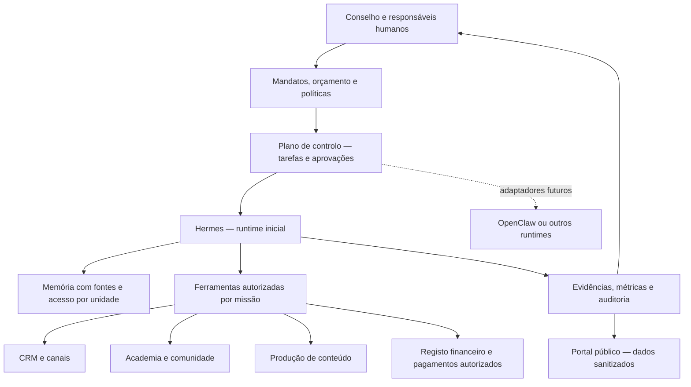

# Genesis / GWD — pesquisa e decisões de arquitetura

Data de verificação: 5 de novembro de 2026. Documento de pesquisa para o plano empresarial e a demonstração pública. Os projetos externos foram consultados como referências, sem instalar código, importar credenciais ou ativar integrações.

## 1. Conclusão executiva

A tese mais defensável para a GWD é operar funções empresariais completas, com escopo, volume, qualidade e responsabilidade definidos. A AtlasHub fornece a arquitetura e os componentes reutilizáveis. A GWD demonstra a sua aplicação em negócios próprios e em serviços a clientes. Genesis organiza a construção, a documentação e a participação.

A prioridade proposta é validar uma operação de educação/comunidade e uma oferta B2B de conteúdo ou atendimento comercial. O portefólio pode descrever desde já as restantes unidades. A contratação, o consumo de modelos e a infraestrutura de cada unidade crescem quando existir procura e capacidade de entrega demonstradas.

O escritório 3D e a galáxia de conhecimento têm valor como instrumentos de explicação, navegação e observação. Cada elemento deve abrir um cartão real com missão, responsável humano, permissões, estado e evidências. A animação pública deve identificar claramente se representa uma simulação ou dados operacionais recentes.

## 2. Verificação das alegações do anexo

| Alegação | Resultado da verificação | Utilização no Genesis |
|---|---|---|
| Menlo estima US$177 mil milhões em IA empresarial em 2026 | Confirmada. A fonte apresenta US$176,8 mil milhões em ritmo anualizado até setembro de 2026. A pesquisa inclui cerca de 400 decisores empresariais dos EUA, recolhida de 8 a 26 de setembro, e uma estimativa bottom-up. | Contexto do mercado global. Não converter esse total em mercado diretamente captável pela GWD. |
| McKinsey, 25/08/2026, 40% grandes empresas versus 22% menores a escalar agentes | Confirmada na página oficial. Os 40% referem-se a respostas de organizações com mais de US$1 mil milhão de receita anual. | Justifica investigar a necessidade de capacidade de implantação nas empresas menores. Não comprova disposição para pagar no Brasil. |
| Sequoia, Julien Bek, Services: The New Software, março de 2026 | Confirmados autor, título e publicação em 5 de março de 2026. | Fundamenta a hipótese comercial de vender execução de trabalho. É uma tese de investimento. |
| a16z, IA vertical colaborativa e dados multimodais como infraestrutura | Confirmado em Big Ideas 2026, parte 1. Alex Immerman aborda colaboração e Jennifer Li aborda dados multimodais. | Inspira memória com proveniência, colaboração entre funções e integração com processos de clientes. |
| GWD já opera todos os componentes citados | O anexo é uma proposta. Esta pesquisa não verificou os deployments, contratos, vendas ou integrações internos. | Manter os estados “demonstrado”, “em implantação”, “planeado” e “dependente de parceiro” por componente. |

Fontes primárias: [Menlo Ventures, relatório e metodologia](https://menlovc.com/perspective/2026-the-state-of-enterprise-ai/), [McKinsey, pesquisa 2026](https://www.mckinsey.com/capabilities/quantumblack/our-insights/the-state-of-ai), [Sequoia, Services: The New Software](https://sequoiacap.com/article/services-the-new-software), [a16z, Big Ideas 2026 — parte 1](https://a16z.com/newsletter/big-ideas-2026-part-1/).

A leitura completa da McKinsey acrescenta uma ressalva material ao plano. A proporção de respondentes que atribuem algum impacto no EBIT à IA permaneceu em 37%, enquanto cerca de 20% referem limitações de utilização por custos. Ganhos individuais de produtividade não bastam para demonstrar rentabilidade empresarial. O piloto Genesis deve medir margem, retrabalho e horas humanas por entrega.

## 3. Referências técnicas e papel proposto

| Componente | Evidência consultada | Papel recomendado | O que falta provar no nosso ambiente |
|---|---|---|---|
| Hermes Agent / Nous Research | Repositório oficial documenta ferramentas, memória, skills, MCP, agendamento e aprovações. | Runtime inicial para missões de pesquisa, operações e produção de artefactos. | Versão fixada, limites de ferramentas, recuperação de falhas, custo por missão e qualidade sobre tarefas GWD. |
| Paperclip | Organogramas, tarefas, execução, aprovações, custos e adaptadores. Documentação atual inclui Hermes local, Hermes gateway e OpenClaw gateway. | Plano de controlo para objetivos, responsáveis, tarefas e execução observável. | Compatibilidade da versão concreta, isolamento por empresa e recuperação após interrupção. |
| OpenClaw | Projeto oficial e documentação de fronteiras de confiança. | Alternativa para unidades que precisem dos seus canais e ferramentas. | Um gateway por fronteira de confiança. Clientes independentes precisam de separação efetiva de credenciais e ambientes. |
| Agency Agents | Catálogo de definições de agentes com missão, processos, regras e métricas. | Matéria-prima editorial para perfis de funções e critérios de entrega. | Adaptar as definições, testar competências e conceder ferramentas explicitamente. Um perfil textual não entrega uma equipa operacional por si só. |
| GBrain | O projeto público garrytan/gbrain oferece memória explícita com fontes, correções, retirada e partilha entre agentes. | Candidato para memória empresarial portátil, com registos de proveniência. | Confirmar se é o mesmo GBrain utilizado internamente. Rever retenção, exportação, backup completo e acessos por tenant. |
| Modelos de linguagem, incluindo DeepSeek | Modelos são consumidos pelos runtimes através de fornecedores compatíveis. | Routing de modelos por tarefa, sensibilidade e custo. | Medir sucesso e revisão humana, fixar limites de consumo e fallback. Modelo, runtime e plano de controlo são camadas distintas. |

Referências: [Hermes oficial](https://github.com/NousResearch/hermes-agent), [documentação Hermes](https://hermes-agent.nousresearch.com/docs/), [Paperclip](https://github.com/paperclipai/paperclip), [adaptadores Paperclip](https://github.com/paperclipai/paperclip/blob/master/docs/adapters/overview.md), [OpenClaw](https://github.com/openclaw/openclaw), [segurança OpenClaw](https://docs.openclaw.ai/gateway/security), [Agency Agents](https://github.com/msitarzewski/agency-agents), [GBrain](https://github.com/garrytan/gbrain).

GBrain merece avaliação específica. O seu README permite começar com recuperação por palavras-chave sem chaves e acrescentar pesquisa semântica posteriormente. Fornecedores cloud de embeddings ou síntese podem receber os textos processados. O próprio projeto avisa que uma exportação Markdown não equivale a backup completo da base. Estes detalhes tornam inadequada uma promessa de “memória privada universal” sem configuração e teste.

## 4. Arquitetura de referência para o piloto

Decisão proposta para 90 dias: escolher um runtime principal, um plano de controlo e um catálogo pequeno de tarefas. Cada departamento existe no organograma e no catálogo, mas pode partilhar o mesmo runtime e os mesmos especialistas. Agentes são ativados por eventos e missões, com limites, em vez de executar ciclos permanentes em cada departamento.

O guia da Anthropic distingue workflows previsíveis de agentes que escolhem dinamicamente ferramentas e passos. Recomenda aumentar a complexidade conforme a necessidade, considerando custo e latência. Aplicação GWD: confirmação de pagamento, concessão de acesso, cálculo de orçamento e controlo de consentimento devem ser workflows verificáveis; pesquisa e proposta criativa podem usar decisões do modelo. [Building effective agents](https://www.anthropic.com/research/building-effective-agents).

## 5. Escritório 3D, mapa de conhecimento e observação

### Escritório

Three.js oferece cena, câmara e renderizador para construir uma experiência WebGL. A referência [AI Office de Gaurav Mishra](https://github.com/Gaurav2693/ai-office/blob/main/README.md) demonstra um escritório isométrico com agentes animados, salas e reuniões. O autor identifica-o como visualização frontend sem chamadas a APIs de IA. Usar essa ideia de leitura espacial e criar o design próprio da AtlasHub, com atribuições de licença caso haja reutilização de código ou assets. [Manual Three.js](https://threejs.org/manual/pages/creating-a-scene.html).

Não usar mirrors encontrados na pesquisa como origem de instalação. Foi encontrado um mirror com instruções de clone apontando para um ZIP e identificação de autor diferente do proprietário do repositório. A origem preferida para análise é Gaurav2693/ai-office. Nenhum instalador foi executado.

### Galáxia de conhecimento

[3d-force-graph](https://github.com/vasturiano/3d-force-graph) oferece nós, ligações, navegação orbital, foco e partículas. Pode representar projetos, documentos, agentes, departamentos, ferramentas e evidências. A taxonomia deve usar tipos e relações explícitas. Um grafo decorativo não demonstra memória funcional.

Proposta de objetos navegáveis:

- Departamento — mandato, responsável, orçamento, projetos e próximos marcos.
- Agente — runtime, versão, competências verificadas, ferramentas permitidas, aprovação necessária e última execução.
- Projeto — fase, cliente ou marca, investimento proposto, custo real disponível e evidências.
- Documento — título, versão, origem, proprietário e classificação de acesso.
- Evento — momento, ator, tarefa, ação, resultado e referência de auditoria.

### Estados de demonstração e produção

O mesmo contrato visual pode apresentar eventos sintéticos na demonstração e eventos sanitizados em operação. Cada evento deve trazer `source_mode` igual a `simulation` ou `observed`, juntamente com horário e origem. A UI não deve converter “tarefa animação concluída” em “venda efetuada”.

No telemóvel, limitar a densidade de objetos e a resolução do renderizador, oferecer pausa e respeitar redução de movimento. A lista HTML de departamentos deve permitir acesso às mesmas informações quando WebGL não estiver disponível. Carregar o ambiente pesado apenas quando o visitante abrir a demonstração.

## 6. Conteúdo audiovisual curado

1. [Building more effective AI agents — Anthropic](https://www.youtube.com/watch?v=uhJJgc-0iTQ). Conversa técnica sobre padrões multiagente, ferramentas e contexto. Usar como leitura do laboratório, com exercício para desenhar um workflow e identificar quais decisões precisam de autonomia.
2. [Hermes gives you wings: Build on open foundations — AI Engineer NYC 2026](https://ai.engineer/nyc/2026/talks/nous). Página oficial do evento de 13 de outubro de 2026, com vídeo e transcrição da apresentação da Nous. Útil para discutir runtime aberto, portabilidade e dependência de fornecedores. As afirmações do orador são a posição da Nous.
3. [How We Build Effective Agents — Barry Zhang, Anthropic, AI Engineer](https://www.youtube.com/watch?v=D7_ipDqhtwk). Sessão técnica apresentada por um engenheiro do fornecedor. Usar para comparar workflows, agentes e avaliação.

Publicar o player oficial ou o link, identificar autor e canal e acrescentar análise AtlasHub. Não copiar vídeos nem apresentar os produtores como parceiros comerciais da AtlasHub sem acordo.

## 7. Provas que tornam o projeto investível

As fontes externas sustentam a oportunidade e fornecem padrões técnicos. A demonstração precisa acrescentar evidência própria.

| Prova | Evidência mínima |
|---|---|
| Procura | Conversas com compradores, problema documentado e propostas com escopo e preço |
| Entrega | Uma missão completa com entrada, artefacto, revisão humana e aceite |
| Economia | Tokens, ferramentas, horas humanas, retrabalho e suporte contabilizados por entrega |
| Repetibilidade | A mesma tarefa executada várias vezes sem depender de uma demonstração preparada manualmente |
| Segurança operacional | Acesso segregado, consentimento, gestão de segredos, limites e recuperação demonstrados |
| Receita | Pagamento efetivamente recebido, custo de entrega e margem reconciliados |

O primeiro pacote demonstrável sugerido é uma campanha de educação GWD ou Viva Leve. O segundo é atendimento/qualificação comercial para um cliente piloto. Expansões reguladas ficam documentadas com parceiro e responsabilidade profissional como requisitos de ativação.

## 8. Registo de riscos e decisões abertas

- **Despesas pequenas repetidas.** Heartbeats, reruns e cadeias multiagente podem gerar consumo sem receita. Limitar orçamento por missão e cancelar execuções sem progresso.
- **Dados entre clientes.** Memória partilhada exige permissões e recuperação isolada. Uma etiqueta de empresa no prompt não constitui isolamento.
- **Prompt injection.** Páginas, mensagens e ficheiros externos são dados. As autorizações para publicar, gastar ou alterar acessos pertencem ao plano de controlo.
- **Aquisição de clientes.** O catálogo de departamentos não substitui distribuição. Cada oferta precisa de público, canal, proposta e acompanhamento.
- **Trabalho humano omitido.** Apresentar fluxo de caixa e custo económico separadamente, incluindo o tempo dos fundadores e a revisão.
- **Governança.** Agentes fornecem propostas e registos. O conselho jurídico e os votos societários pertencem às pessoas e entidades formalmente habilitadas.
- **Origem do software.** Fixar versões e licenças, verificar dependências, manter atribuições e preferir repositórios oficiais.
- **Interesse de investimento.** Uma intenção registada no funil não equivale a subscrição, captação concluída ou capital recebido. As condições e o instrumento da operação precisam de documentação própria antes de uma cobrança de investimento.

## 9. Critérios de seleção de novas unidades

Pontuar cada unidade de 1 a 5 para procura comprovada, acesso ao cliente, repetibilidade, margem após revisão, aproveitamento da stack e rapidez de recebimento. Registar separadamente complexidade regulatória, sensibilidade dos dados e capital em risco. Começar pelas unidades com maior evidência e menor custo de validação.

Conjunto inicial sugerido: Education & Communities, Media & Growth, Sales & Customer Operations. Digital Commerce e marcas próprias avançam com limites de tráfego e unidade económica medida. Seguros, crédito, contabilidade, imobiliário e legal operations entram por serviços a parceiros habilitados, com escopo contratual explícito.

Esta classificação é uma recomendação de projeto. Não foi obtida por estatística de mercado nem constitui previsão de receitas.

